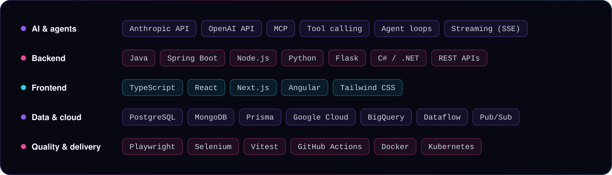

I've spent 18 years building production software: backend services, cloud data pipelines, web apps, and the test suites that keep them honest. I've shipped systems for healthcare, finance, banking and SaaS.

Now I build AI agents. These are LLM apps that call real tools, make decisions you can audit, and fail safely when the model gets it wrong.

## Featured work

### [Agentdeck](https://github.com/s-talha/agentdeck)

Build AI agents with tools, run them, and watch every step they take. Each model turn and tool call streams in live, and every run is saved as a replayable trace.

<a href="https://github.com/s-talha/agentdeck"></a>

`Next.js` `TypeScript` `PostgreSQL` `Prisma` `Auth.js` `Server-Sent Events` `Playwright`

### [Helpdesk MCP server and triage agent](https://github.com/s-talha/helpdesk-mcp)

A support helpdesk exposed as an MCP server that Claude Desktop or any MCP client can use, plus an agent that connects to it over MCP and triages tickets on its own. Tools are typed and annotated as read-only or write, a read-only mode hides write tools entirely, the agent asks a person before every write, and every write is audited.

```text
$ helpdesk-agent "Triage the urgent open tickets"
model   I'll find the urgent open tickets first.
call    search_tickets(status=open, priority=urgent)
call    get_ticket(2), get_ticket(1), get_ticket(3)
call    search_kb("Teachers locked out after SSO change")
result  sso-setup: Setting up single sign-on
call    add_comment(3, internal note)
model   Left an internal note on each ticket. Nothing was sent to customers.
```

`Python` `Model Context Protocol` `Pydantic` `SQLite` `pytest` `GitHub Actions`

### [AI Support Ticket Triage Agent](https://github.com/s-talha/support-triage-agent-source)

Reads incoming support tickets, classifies them with an LLM, and decides whether to answer automatically or hand off to a person. The routing rules are plain code, not the model, so they can be tested and audited. If classification fails, the ticket goes to a human by default.

`Python` `Flask` `Anthropic` `OpenAI`

### Currently building

**Real estate lead agent** (private repo, in progress): an AI agent that handles incoming leads for real estate brokers in the US market.

## How I build

- **The model suggests, code decides.** LLMs classify and draft. Anything with real consequences goes through rules you can read and test.
- **Every run is traceable.** You should be able to open any answer and see the steps, tool calls and inputs behind it.
- **It runs without keys.** My projects include a demo mode, so anyone can clone and try them in a minute.
- **Tested like production.** Unit tests for the logic, end-to-end tests for the flows, CI on every push.

## Stack



## Get in touch

Based in Stockholm and open to new projects and roles, remote or on site. See more on my portfolio site, **[s-talha.github.io](https://s-talha.github.io)**.


